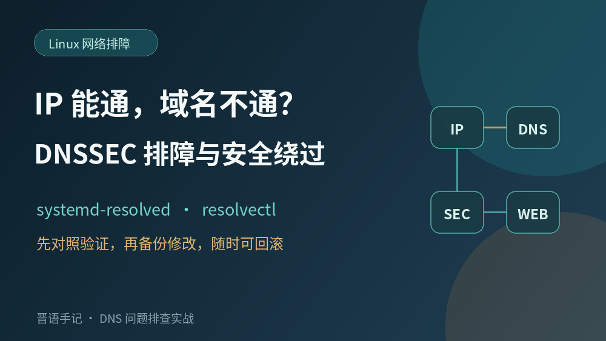

# 能 ping 通 IP 却打不开网页：systemd-resolved 的 DNSSEC 排障与安全绕过



电脑明明显示“网络已连接”，公网 IP 也能 ping 通，浏览器却打不开网页，微信或其他已经建立连接的软件甚至可能继续工作。

这次真实案例发生在公司网络中：**IT 部门突然调整了 DNS 设置后，原本正常工作的银河麒麟电脑开始出现域名解析失败，而同一网络里的 Windows 电脑仍能正常上网。**故障不是用户自己修改了网络，也不是网卡或驱动突然损坏，而是上游 DNS 变化触发了不同操作系统解析策略的差异。

在这次银河麒麟环境中，系统缺省开启了 DNSSEC 验证，而公司 DNS 服务器未提供与其验证要求相匹配的 DNSSEC 支持。结果是上游 DNS 策略改变后，systemd-resolved 无法通过验证，域名解析随即失效。Windows 默认的 DNS 客户端解析与验证策略不同，因此没有在同一变化下表现出相同故障。

这类问题最典型的背景是：**网络侧刚刚调整了 DNS，Linux/银河麒麟集中异常，Windows 却基本正常。**它提醒我们，排障时不能只问“网络有没有断”，还要问“不同系统的 DNSSEC 和解析器行为是否一致”。

本文把这条排障链路完整展开，并修正一个容易误解的说法：**DNSSEC 不是“响应没有签名就一律失败”，关闭 DNSSEC 也不是所有内网问题的通用修复。**只有在证据吻合时才应临时绕过，长期仍应修复上游 DNS、签名或信任链。

## 一、通常什么背景下会出现这类故障

### 1. 上游 DNS 或网络策略刚发生变化

常见触发点包括：

- IT 部门更换或调整公司 DNS 服务器；
- DNS 转发器、上游出口或安全设备策略发生变化；
- 内网域名、Split DNS 或转发规则被重新配置；
- 用户切换到另一个办公网络、有线网络、Wi-Fi 或 VPN；
- DHCP 下发了新的 DNS 地址。

如果多台同系统设备在相近时间出现相同问题，应优先询问近期是否有统一变更，而不是逐台重装驱动或系统。

### 2. 同一网络里，不同操作系统表现不同

本次案例中最有辨识度的对照是：

| 设备或解析环境 | 在这次公司 DNS 调整后的表现 | 原因方向 |
|---|---|---|
| 缺省启用 DNSSEC 的银河麒麟 / systemd-resolved | 域名解析失败，网页无法打开 | 本机验证要求与上游 DNS 响应不匹配 |
| 其他启用 DNSSEC 验证的 Linux 设备 | 可能出现相同或类似故障 | 取决于解析器、版本和配置 |
| 公司网络中的 Windows 电脑 | 本次可以正常工作 | 默认 DNS 客户端并未按相同方式执行 DNSSEC 验证 |
| 使用独立 DNS 客户端、代理或加密 DNS 的应用 | 可能不受影响 | 可能绕过了系统解析路径 |
| 已有有效缓存的设备 | 可能暂时正常，之后出现异常 | 缓存尚未过期，不代表没有故障 |
| 手机、macOS 或其他终端 | 不能仅凭系统名称判断 | 需要看其实际解析器和验证策略 |

“Windows 正常、银河麒麟异常”并不意味着 Windows 的 DNS 一定更安全或银河麒麟存在缺陷，而是两者对上游变化的容忍和验证路径不同。

### 3. 故障主要影响域名访问，不一定影响所有网络连接

可能同时看到：

- 已连接的微信或长连接业务暂时继续工作；
- 直接通过 IP 访问的服务仍可使用；
- 新打开的网站因为需要解析域名而失败；
- 已缓存的域名短期可用，缓存过期后失败；
- 不同网卡使用不同 DNS 时，只有一个连接异常。

因此，这类故障表面上像“突然断网”，本质上可能是**系统与上游 DNS 的兼容问题**。

## 二、先看现象：链路通，不代表 DNS 正常

访问网站通常至少需要几个环节：

```text
网卡与链路
  → 获取 IP 和网关
  → 路由到达目标网络
  → DNS 把域名解析成地址
  → 建立 TCP/TLS 连接
  → 网页返回内容
```

`ping` 一个公网 IP 成功，只能说明其中一部分链路可用。它没有经过域名解析，因此不能证明 DNS 正常。

本次素材记录的典型现象包括：

- 网络图标显示已连接；
- IP 地址、网关和路由看起来正常；
- ping 公网 IP 可以成功；
- ping 域名或浏览器访问失败；
- 某个网络正常，切换到另一个网络后异常；
- 故障可能间歇出现，与当前选择的上游 DNS 有关。

所以，遇到这种问题时，不必第一时间重装网卡驱动。先把“网络连通”和“域名解析”分开测试。

## 三、DNSSEC 到底在验证什么

DNS 最初的设计没有为响应提供完整的来源与完整性验证。DNSSEC 通过数字签名和信任链，让解析器能够检查：

- 响应是否真的来自有权发布该区域数据的服务端；
- 记录是否在传输过程中被篡改；
- 某些“记录不存在”的回答是否具有可信的否认证明。

这里有一个非常重要的边界：

> **正常互联网中，并不是所有域名都部署 DNSSEC。未部署 DNSSEC 的区域可以返回未签名结果，这不等于解析失败。**

真正需要警惕的是：解析器根据信任链判断某段数据应当具有有效签名，却没有获得可以验证的记录，或者签名、信任锚、转发过程出现矛盾。

素材中记录过类似错误：

```text
DNSSEC validation failed: no-signature
```

看到这一错误，才可以把 DNSSEC 验证列为重点方向。不能仅凭“这是企业内网”就下结论。

## 四、第一步：确认系统是否使用 systemd-resolved

本文方法适用于使用 `systemd-resolved` 的 Ubuntu、Debian、银河麒麟部分桌面环境以及其他采用相同解析栈的 Linux 系统。

先检查：

```bash
readlink -f /etc/resolv.conf
cat /etc/resolv.conf
resolvectl status
```

如果 `/etc/resolv.conf` 指向 `127.0.0.53`，通常说明本机应用正通过 systemd-resolved 的本地 stub 监听器查询 DNS。

也可能看到 `127.0.0.54`，或者由 NetworkManager、其他 DNS 服务生成不同配置。因此，不要只凭文件中的某一行认定所有系统都相同。

如果 `resolvectl` 命令不存在，或者提示 systemd-resolved 未运行，本文的 DNSSEC 设置方法就不适用，应先查清本机实际使用的解析服务。

## 五、第二步：把 IP 连通和域名解析分开

### 1. 检查地址与路由

```bash
ip address
ip route
```

确认网卡有有效地址，并存在符合当前网络环境的默认路由或专用路由。

### 2. 测试网关与一个已知可达 IP

```bash
ping -c 3 <你的网关地址>
ping -c 3 <你确认可达的测试IP>
```

尖括号内容必须替换为实际地址。公网测试 IP 也可能被当前网络策略禁止，ping 不通并不能单独证明网络完全中断。

### 3. 测试域名解析

```bash
resolvectl query www.baidu.com
```

可能出现两类结果：

- 返回 IP 地址：本次解析成功，应继续检查代理、TCP、TLS 或应用；
- 返回 DNS 错误：根据错误文字继续判断，包括超时、SERVFAIL、NXDOMAIN 或 DNSSEC 验证失败。

这一步的重点不是记住某个网站，而是保存**完整错误输出**。

## 六、第三步：直接查询上游 DNS，绕开本机解析器

先找到当前连接实际使用的 DNS：

```bash
resolvectl status
```

在对应网卡的 `Current DNS Server` 和 `DNS Servers` 中查看地址。不要从旧笔记里复制别人的内网 DNS。

然后使用 `dig` 直接查询这个上游：

```bash
dig @<实际上游DNS地址> www.baidu.com
```

如果系统没有 `dig`，也可以使用已有的 `nslookup`：

```bash
nslookup -timeout=3 www.baidu.com <实际上游DNS地址>
```

结果可以这样理解：

| 直接上游查询 | 通过 systemd-resolved 查询 | 优先排查方向 |
|---|---|---|
| 成功 | DNSSEC 验证失败 | 本机验证、上游转发与 DNSSEC 数据完整性 |
| 成功 | 超时或无响应 | 本机解析服务、路由选择、缓存或配置 |
| SERVFAIL | SERVFAIL | 上游 DNS、转发器、区域或签名问题 |
| NXDOMAIN | NXDOMAIN | 域名是否存在、搜索域和内外网 Split DNS |
| 超时 | 超时 | 上游不可达、UDP/TCP 53 被拦截或网络策略 |

“直接上游成功”不是绝对证明上游完全正常。上游可能能返回普通记录，却在 DNSSEC 所需的 DNSKEY、DS、RRSIG 等记录或大包、TCP 查询上存在问题。

## 七、第四步：做一个不修改配置的 DNSSEC 对照测试

`resolvectl query` 支持在本次查询中控制是否允许 DNSSEC 验证：

```bash
resolvectl query www.baidu.com
resolvectl query --validate=no www.baidu.com
```

如果正常查询明确报 DNSSEC 验证失败，而 `--validate=no` 能返回结果，这就是很强的定位线索。

但它仍然只是一次对照测试：

- 第二次成功可能受到缓存影响；
- 更换域名或记录类型后结果可能不同；
- 上游故障仍可能同时存在；
- 它不能证明关闭 DNSSEC 是长期最佳方案。

必要时先记录缓存状态，再做进一步测试：

```bash
resolvectl statistics
resolvectl show-cache
```

不要为了“清一下试试”而反复 flush 缓存；保留现场往往比盲目操作更有价值。

## 八、第五步：检查当前 DNSSEC 模式和上游状态

```bash
resolvectl status
resolvectl show-server-state
```

重点查看：

- Global 和具体网卡的 DNSSEC 设置；
- 当前选择了哪个 DNS 服务器；
- 不同网卡是否拥有不同的 DNS 与 Domain 路由；
- 上游功能状态是否异常。

不同 systemd 版本的默认 DNSSEC 模式和输出格式可能不同，不要用“所有系统默认都是 allow-downgrade”代替本机检查。

还可以查看配置文件：

```bash
cat /etc/systemd/resolved.conf
ls -la /etc/systemd/resolved.conf.d/
```

配置可能被 drop-in 文件覆盖，不能只检查主文件。

## 九、确认是兼容问题后：临时关闭 DNSSEC 做验证

只有在满足以下条件时，才建议使用这一步：

1. 正常解析明确出现 DNSSEC 验证错误；
2. 直接上游查询或 `--validate=no` 对照支持这一判断；
3. 已记录修改前状态；
4. 理解关闭验证会降低 DNS 响应完整性保护。

临时设置：

```bash
sudo resolvectl dnssec global no
```

随后立即验证：

```bash
resolvectl query www.baidu.com
```

如果恢复，说明 DNSSEC 设置与故障高度相关，但仍需联系网络或 DNS 运维人员修复上游。

恢复原设置时，应按修改前的真实值执行。例如原值是 `allow-downgrade`：

```bash
sudo resolvectl dnssec global allow-downgrade
```

如果原值是 `yes`，则恢复为 `yes`，不要照抄示例。

## 十、需要持续绕过时：用 drop-in 配置并保留回滚

在 managed 网络或暂时无法修复上游的环境里，可能需要让设置持续生效。相比反复用 `sed` 编辑主文件，独立 drop-in 更容易备份和撤销。

### 1. 备份现状

```bash
mkdir -p "$HOME/dnssec-backup"
cp -a /etc/systemd/resolved.conf "$HOME/dnssec-backup/resolved.conf.before"
resolvectl status > "$HOME/dnssec-backup/resolvectl-status.before.txt"
```

如果已有同名 drop-in，也应先备份：

```bash
if [ -f /etc/systemd/resolved.conf.d/90-local-dnssec.conf ]; then
  cp -a /etc/systemd/resolved.conf.d/90-local-dnssec.conf \
    "$HOME/dnssec-backup/90-local-dnssec.conf.before"
fi
```

### 2. 创建配置目录和 drop-in

```bash
sudo install -d /etc/systemd/resolved.conf.d
printf '[Resolve]\nDNSSEC=no\n' | \
  sudo tee /etc/systemd/resolved.conf.d/90-local-dnssec.conf
```

### 3. 重启并验证

```bash
sudo systemctl restart systemd-resolved
resolvectl status
resolvectl query www.baidu.com
```

重启解析服务可能短暂影响域名解析。远程维护服务器前，应确认带外管理或备用连接，避免在唯一的远程会话里盲目操作。

### 4. 回滚

如果此前没有这个 drop-in：

```bash
sudo rm /etc/systemd/resolved.conf.d/90-local-dnssec.conf
sudo systemctl restart systemd-resolved
```

如果此前已有文件，则应恢复备份，而不是直接删除：

```bash
sudo cp -a "$HOME/dnssec-backup/90-local-dnssec.conf.before" \
  /etc/systemd/resolved.conf.d/90-local-dnssec.conf
sudo systemctl restart systemd-resolved
```

回滚后再次检查 `resolvectl status`，确认恢复为原来的 DNSSEC 模式。

## 十一、为什么不建议直接改用公共 DNS

把 DNS 改成公共服务器，有时可以绕过故障上游，但它不是企业或内网环境的通用解法。

可能造成的问题包括：

- 内部域名无法解析；
- Split DNS 失效，访问走到错误入口；
- 绕过单位要求的 DNS 审计与安全策略；
- 多网卡环境下改变默认路由选择；
- 应用仍能解析，但访问区域、延迟或结果发生变化。

只有在不依赖内部域名、网络策略允许、并明确知道自己在修改哪个连接时，才考虑公共 DNS。不要把某次案例里的内网服务器地址或公共 DNS 组合直接复制到所有机器。

## 十二、验证不能只看 ping

修复后至少做三层验证。

### 1. 解析验证

```bash
resolvectl query www.baidu.com
```

应返回地址，不再出现原来的 DNSSEC 错误。

### 2. HTTP/HTTPS 验证

```bash
curl -I --max-time 10 https://www.baidu.com
```

能返回 HTTP 响应头，说明域名解析、TCP 和基本 TLS/HTTP 链路均已走到服务端。状态码是否为 200 不是唯一判断，301、302 等同样说明已经获得 HTTP 响应。

### 3. 实际业务验证

如果机器依赖内部系统，还必须测试：

- 内部域名；
- 认证门户；
- 内部代理；
- 专用应用；
- 其他网卡或 VPN 的域名解析。

公网网页恢复，不代表内部 DNS 和业务访问也完全正常。

## 十三、长期修复应该查什么

关闭 DNSSEC 只是绕过验证。要让网络真正恢复健康，应由 DNS 或网络运维人员继续检查：

- 上游 DNS 是否正确转发 DNSSEC 相关记录；
- 区域签名是否过期、缺失或与上级 DS 不一致；
- 是否存在中间设备篡改或过滤 DNS 响应；
- UDP 大包、EDNS、TCP 53 是否可用；
- 内部区域与公共区域的信任链是否被错误混用；
- 多上游服务器返回的数据是否不一致；
- 本机信任锚和 systemd-resolved 版本是否存在已知问题。

这些项目需要根据实际区域、日志和 DNS 数据验证，不能从一条 `no-signature` 错误直接推定唯一根因。

## 十四、关于一键修复脚本

针对这次已经确认原因的故障，原始资料还提供了 `fix-dns.sh` 和双击启动器，方便不熟悉命令行的用户快速完成修复。

其中，`fix-dns.sh` 是可读的 Shell 脚本，适合在终端中运行：

```bash
bash fix-dns.sh
```

双击启动器则面向普通桌面用户：解压修复工具后，按照随附说明运行，并根据提示输入当前用户的管理员密码。执行结果会保存到用户目录下的 `fix-dns-result.txt`，便于后续反馈和复查。

脚本适用于已经按照前文确认“systemd-resolved 的 DNSSEC 验证与公司 DNS 不兼容”的环境。如果故障原因尚未查明，应先完成诊断，不要把一键修复当成所有网络问题的通用工具。

修复脚本会：

1. 尝试关闭 DNSSEC；
2. 修改 `/etc/systemd/resolved.conf`；
3. 重启 systemd-resolved；
4. 输出解析与 ping 测试结果。

公开使用时需要补上原稿缺少的环节：

- 修改前备份；
- 明确适用环境；
- 记录原 DNSSEC 值；
- 操作失败时停止，而不是继续宣称修复；
- 提供回滚方法；
- 不把 ping 通域名当成完整 Web 验证。

另外，图形启动器把 Shell 以 Base64 内嵌，普通用户很难审计。更稳妥的方式是直接提供可读脚本，让人先查看内容，再决定是否执行。不要运行来源不明、无法阅读或没有回滚方案的“网络修复工具”。

## 十五、常见误判

### 误判 1：能 ping IP，DNS 就一定正常

不对。ping IP 不经过域名解析。

### 误判 2：没有 DNSSEC 签名就一定会失败

不对。未部署 DNSSEC 的区域可以正常返回未签名结果，关键是信任链和验证预期。

### 误判 3：关闭 DNSSEC 后恢复，上游就完全没问题

不对。关闭验证可能只是绕过了上游转发、签名或信任链异常。

### 误判 4：换公共 DNS 一定更稳定

不对。它可能破坏内网域名、Split DNS 和网络管理策略。

### 误判 5：ping 域名成功就代表网页一定正常

不对。后续还有代理、TCP、TLS、HTTP 服务和应用自身问题。

### 误判 6：所有 Linux 都使用 systemd-resolved

不对。不同发行版和服务器可能使用 dnsmasq、Unbound、BIND、NetworkManager 直接配置或其他方案。

## 十六、推荐用法：交给 AI 协助实施

> [!important]
> 可以把本文交给正在操作故障电脑的 AI 助手，让它先收集证据再判断是否涉及 DNSSEC。不要一开始就让 AI 关闭验证、换公共 DNS 或重启网络服务。

提示词示例：

```text
请阅读《能 ping 通 IP 却打不开网页：systemd-resolved 的
DNSSEC 排障与安全绕过》，协助我排查当前网络问题。

请严格遵守：
1. 先只读检查 /etc/resolv.conf、resolvectl status、IP、路由和实际 DNS；
2. 分别测试 IP 连通、域名解析和 HTTP/HTTPS，不混淆不同层级；
3. 保存 resolvectl query 的完整错误，不预设一定是 DNSSEC；
4. 使用本机实际上游 DNS 做 dig 或 nslookup 对照，替换所有占位符；
5. 可使用 resolvectl query --validate=no 做单次对照，但先说明缓存影响；
6. 如果不是 systemd-resolved，停止使用本文的 DNSSEC 修改方法；
7. 关闭 DNSSEC、重启服务或修改 DNS 前，先给出证据、影响、备份和回滚方案，
   并等待我的确认；
8. 不擅自改用公共 DNS，不破坏内部域名和多网卡分流；
9. 修改后验证公网与内部域名，失败立即停止并协助恢复；
10. 把临时绕过与上游长期修复分开，不宣称关闭 DNSSEC 就解决了所有问题。
```

## 写在最后

“IP 能通、域名不通”是一条很有效的分流线索；`DNSSEC validation failed` 则把排查进一步缩小到解析验证层面。

但真正可靠的排障不是看到关键词就关闭功能，而是完成三组对照：**本机与上游、启用与关闭验证、公网与内部业务。**临时绕过要有回滚，长期修复要回到 DNS 数据和信任链。这样才能既恢复网络，又不把一个兼容问题变成新的安全隐患。

---

> 原文首发于 Gitee：<https://gitee.com/digtip/notes/blob/main/blog/dev/%E8%83%BD%20ping%20%E9%80%9A%20IP%20%E5%8D%B4%E6%89%93%E4%B8%8D%E5%BC%80%E7%BD%91%E9%A1%B5%EF%BC%9Asystemd-resolved%20%E7%9A%84%20DNSSEC%20%E6%8E%92%E9%9A%9C%E4%B8%8E%E5%AE%89%E5%85%A8%E7%BB%95%E8%BF%87.md>
