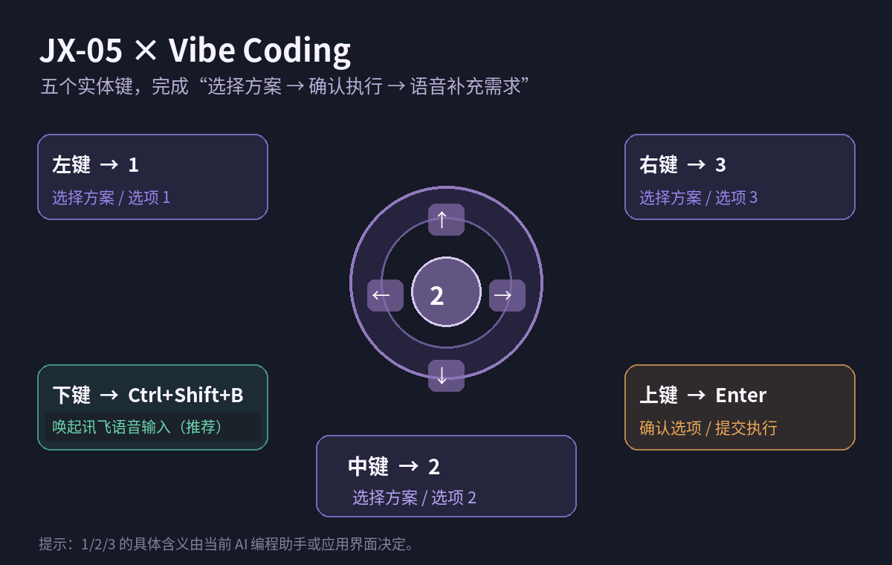

# 把 JX-05 蓝牙遥控戒指变成 Vibe Coding 控制器：五键选择、确认与语音输入


一只原本用来刷短视频、翻电子书的蓝牙遥控戒指，放到 Linux 桌面上还能做什么？

我的答案是：**把它变成 AI 编程时随手拿起的五键控制器。**

左、中、右三个键分别发送 `1`、`2`、`3`，用来选择 AI 编程助手给出的方案；上键是 `Enter`，确认后继续执行；下键不再只是“下一页”，而是发送 `Ctrl+Shift+B`，唤起语音输入，把下一段需求直接说给 AI。我最推荐的搭配是银河麒麟下的**讯飞语音输入法**。

于是，原本需要在键盘、鼠标和语音之间来回切换的操作，被压缩成了一个很顺手的闭环：

> **看一眼方案 → 按 1/2/3 选择 → Enter 确认 → 需要补充时，按下遥控器直接说。**

这篇文章记录我在银河麒麟 V11 上完成 JX-05 按键识别、抓取和重映射的过程，也说明为什么同样的方法可以用于更多蓝牙遥控器，而不只限于这一款产品。

## 一、从手机遥控器到 AI 编程控制器

JX-05 原本是为手机短视频、直播、自拍和翻页设计的。它通过 BLE 连接，系统会把它识别成一个无线键盘。

问题也正在这里：它发出的通常是方向键、音量键、回车和媒体播放键。在手机上，这些事件有明确用途；到了桌面 Linux，按键虽然能被系统收到，却没有我真正需要的功能。

但我日常用 AI 编程助手时，经常遇到两类动作：

1. 助手列出几个选项，要求输入 `1`、`2` 或 `3`；
2. 我想补充一段需求、解释一个现象，或者口述下一步任务。

第一类操作需要数字键和回车，第二类操作需要唤起语音输入。JX-05 正好有五个可操作的键，于是形成了下面这套映射。



| 遥控器按键 | 原事件 | 改造后发送 | 在 Vibe Coding 中的用途 |
|---|---|---|---|
| 左 | `KEY_LEFT` | `1` | 选择当前界面的第 1 个选项 |
| 中 | `KEY_VOLUMEUP` | `2` | 选择当前界面的第 2 个选项 |
| 右 | `KEY_RIGHT` | `3` | 选择当前界面的第 3 个选项 |
| 上 | `KEY_UP` | `Enter` | 确认选择、提交当前操作 |
| 下 | `KEY_DOWN` | `Ctrl+Shift+B` | 唤起或结束讯飞语音输入（推荐），也可适配其他语音方案 |

### 为什么语音热键选择 Ctrl+Shift+B

这个组合不是随手指定的。实际使用中，我先后尝试了多种快捷键，发现常用软件已经占用了大量单键、双击修饰键和常见组合键：编辑器、终端、浏览器、办公套件和输入法各自都有快捷键习惯，看起来好按的组合，往往已经在某个软件里承担了其他功能。

最后保留 `Ctrl+Shift+B`，是因为在我的银河麒麟日常软件环境中，它是**多次尝试后冲突相对较少、同时又能稳定配合语音输入的一组键位**。它不能抽象成“任何软件都绝不冲突”：例如某些开发工具可能把这个组合用于构建任务，换机器或换软件后仍要重新检查。

我推荐的使用方式，是在银河麒麟下把这个组合交给**讯飞语音输入法**。讯飞负责语音采集、识别和上屏，JX-05 负责远程发送热键；按下遥控器，就不用再去键盘上找三键组合。

如果使用的是 fcitx5-vinput 等其他语音方案，也可以复用同一思路，但要分别配置语音服务的热键，并检查全局快捷键和当前应用的占用情况。

### 从按键到语音上屏的完整链路

```text
按下 JX-05 下键
  → 映射程序发送 Ctrl+Shift+B
  → 讯飞语音输入法收到热键
  → 麦克风采集语音并识别
  → 文字进入当前 AI 编程助手的输入框
```

这套分工让遥控器、输入法和 AI 助手各自只做擅长的事，也便于以后单独更换其中一个组件。

`1/2/3` 的实际含义始终由当前应用界面决定，并不是遥控器固定执行“同意”“拒绝”等操作。使用前要看清楚 AI 编程助手当前列出的选项。

## 二、这套组合为什么很顺手

### 1. 选方案时，不必把手放回主键盘

AI 编程助手在终端或交互界面中给出选项时，我可以直接按左、中、右选择，再按上键确认。

它减少的不是一次惊天动地的复杂操作，而是每天反复发生的细小切换：手离开键盘、找鼠标、点选、再回到输入位置。五键控制器把这些动作固定成了肌肉记忆。

### 2. 需要解释需求时，直接说话

下键触发 `Ctrl+Shift+B`，我最推荐与银河麒麟下的**讯飞语音输入法**配合；我的 fcitx5-vinput 本地方案也可以使用同一热键。焦点留在 AI 编程助手的输入框里，就可以口述：

- 补充需求和限制条件；
- 描述刚刚出现的现象；
- 让 AI 解释当前方案；
- 给出下一个小任务；
- 口述一段不想逐字敲入的提示词。

语音输入本身依赖输入法、麦克风和识别服务，JX-05 只负责发送热键，不负责录音或识别。

### 3. 它不是替代键盘，而是补上高频动作

写复杂提示词、检查代码和处理异常时，主键盘仍然不可替代。遥控戒指真正适合的是那些**次数多、语义固定、不需要看键帽**的动作。

这也是改造蓝牙外设最值得遵循的原则：不要试图把十个键变成完整键盘，而要把少量按键变成最顺手的快捷入口。

## 三、商品外观与按键位置


上图是同型号商品参考图，来源为 [Classic Phones 的 JX-05 商品页](https://www.classic-phones.com/products/mobile-phone-bluetooth-ring-remote-control-jx-05)，用于帮助读者识别外观，不是本文的实拍测试图。商品描述中的续航、兼容手机型号等参数不属于本文实测结论。

本文实际验证的是 Linux 输入事件、按键映射和自动重连，不是商品宣传中的所有手机功能。

## 四、改造的第一步：先识别它到底发送了什么

我的实测环境是银河麒麟 V11 桌面版、飞腾 ARM64 笔记本。遥控器通过 BLE 配对，广播名是 `JX-05`，操作系统中的设备名为 `GX05`。

类似产品可能更换固件或事件编码，所以**不要直接照抄我的 key code**。先让系统自己告诉你每个按键是什么。

### 1. 配对并连接

```bash
bluetoothctl power on
bluetoothctl scan on
bluetoothctl pair <你的设备MAC>
bluetoothctl trust <你的设备MAC>
bluetoothctl connect <你的设备MAC>
```

MAC 必须替换为自己的设备地址，不要使用文章里的示例地址。

### 2. 找到输入设备节点

```bash
cat /proc/bus/input/devices
```

我的 JX-05 对应信息是：

```text
Name: "GX05"
Phys: <本机蓝牙适配器MAC>
Handlers: sysrq kbd eventX
```

`eventX` 是动态节点，重启或重新连接后可能变化，不能永久写死。

### 3. 用 evtest 逐键记录

```bash
sudo evtest /dev/input/eventX
```

依次按下五个键，记录 `EV_KEY` 的 `KEY_*` 名称和 value：

- `value 1`：按下；
- `value 0`：释放；
- `value 2`：按住时系统自动重复。

我的实测结果是：

| 按键 | key code | 事件 | 十六进制 |
|---|---:|---|---:|
| 左 | 105 | `KEY_LEFT` | `0x69` |
| 中 | 115 | `KEY_VOLUMEUP` | `0x73` |
| 右 | 106 | `KEY_RIGHT` | `0x6a` |
| 上 | 103 | `KEY_UP` | `0x67` |
| 下 | 108 | `KEY_DOWN` | `0x6c` |

如果另一个遥控器的中键不是 `KEY_VOLUMEUP`，只需要修改映射配置，不必改变整体方案。

## 五、为什么采用 evdev 抓取，而不是桌面全局快捷键

最直接的思路是用桌面环境的全局快捷键工具，把某个键绑定到命令。但这个方案遇到组合键和媒体键时容易受桌面环境限制。

我最终使用的是更底层的链路：

```text
BLE 输入设备
  → evdev 内核事件
  → 用户态抓取与映射
  → xdotool 发送标准键盘事件
  → 当前获得焦点的应用
```

这样做的价值是：

- 映射逻辑不依赖某一个桌面快捷键面板；
- 可以发送 `Ctrl+Shift+B` 这样的组合键；
- 可以独占遥控器，避免原始方向键继续影响当前窗口；
- 即使焦点在终端或 AI 编程助手里，收到的仍然是普通键盘事件。

核心 Python 依赖只有 `python3-evdev`，键盘事件注入使用 `xdotool`。

## 六、映射实现中最关键的几个细节

### 1. 使用 `absinfo` 识别设备，不写死 eventX

JX-05 的 `uniq` 为空，但 `phys` 会带连接它的蓝牙适配器地址。因此程序可以检查 `absinfo[0x3f]` 中的 `uniq/phys`，结合设备名称和 key code 找到目标。

这种方式比 `/dev/input/event21` 更可靠，因为节点编号可能随重连变化。

### 2. 只抓取独占遥控器，不要独占主键盘

找到设备后使用 `EVIOCGRAB` 独占，再由映射程序发送目标键。

这样按左键时，当前窗口不会同时收到“向左移动光标”和数字 `1`。但抓取对象必须是专用遥控器；如果抓错主键盘，正常输入会受到影响。

### 3. 同时处理释放事件

每次注入不仅要发送 key down，也要发送 key up。只按下不释放，会让系统认为某个键一直被按住。

### 4. 用 `--clearmodifiers` 避免修饰键残留

```python
subprocess.run([
    'xdotool', 'key', '--clearmodifiers', target
])
```

如果发送快捷键时 Ctrl、Alt 或 Shift 状态异常，`--clearmodifiers` 可以减少修饰键卡住造成的误操作。

### 5. 设备断开后自动重连

蓝牙遥控器休眠、远离或电量不足时，evdev 节点可能消失。守护程序捕获 `OSError` 后释放旧设备，每隔几秒重新扫描，而不是直接退出。

当前环境已经将守护交给用户级 systemd 管理：

```bash
systemctl --user status jx05-mapper.service
```

服务配置了失败自动重启，登录用户会话后自动运行。早期桌面自启动方式已经被 systemd 方案替代，不建议两套启动方式同时启用。

## 七、一天里的典型使用流程

假设我正在让 AI 编程助手修改一个脚本：

1. 我先用键盘或语音描述任务；
2. AI 给出几个处理方案；
3. 看清编号后，用左、中、右键选择；
4. 按上键确认；
5. AI 执行后返回结果；
6. 如果需要补充背景，按下键唤起语音，直接说“这个方案还要保留原来的回退路径，先不要修改系统服务”；
7. 检查生成内容，再继续下一轮。

这套流程的重点不是“完全不动手”，而是把高频选择、确认和语音入口固定到一个很小的设备上。

它也适合：

- 阅读 AI 给出的多个计划并选择；
- 在终端交互提示中输入编号；
- 长时间结对式讨论方案时快速唤起语音；
- 一边看纸质材料或另一块屏幕，一边做简单确认。

**涉及删除数据、生产发布、支付或其他高风险操作时，不应仅凭遥控器一键确认。**先读清楚界面内容，高风险步骤仍应保留人工检查。

## 八、这套方法不只适用于 JX-05

只要设备在 Linux 中表现为标准输入设备，并能通过 evdev 看到稳定的按键事件，就可以复用同样的方法。

### 1. 蓝牙翻页器

把上一页、下一页改成 AI 助手的选项切换，或映射为终端历史命令、标签页切换。

### 2. 演示翻页笔

除了控制幻灯片，还可以将激光笔上的备用按键映射为“开始/停止语音说明”或“切换到指定应用”。

### 3. 蓝牙自拍遥控器

单键设备可以只承担一个动作，例如唤起语音、开始录音或确认当前非危险操作。键越少，越应该聚焦一个高频任务。

### 4. 小型蓝牙数字键盘

可以建立一套 AI 工作流面板：常用提示词、窗口切换、语音输入、截图和终端命令分别占用一个键。

### 5. 其他 HID 外设

部分 USB 或 2.4G 接收器设备同样会生成 evdev 事件。本文的方法本质上不依赖 BLE，只要输入事件可识别，就可以尝试映射。

### 通用改造流程

```text
确认设备类型
  → evtest 读取真实事件
  → 设计少量高频动作
  → evdev 独占与重映射
  → 验证焦点、释放键和修饰键
  → 增加自动重连
  → 用 systemd 托管
```

更换设备时，通常只需要调整设备识别条件、key code 和目标动作，不需要推翻整个架构。

## 九、不要忽略这些边界

- **JX-05 没有单独的 Pair 键。**长时间无操作后会休眠，按一下键可唤醒并重连。
- **设备名和事件可能随固件变化。**购买同型号产品也不能保证 key code 完全一致。
- **xdotool 依赖 X11/XTEST。**Wayland 或受限制会话需要改用相应输入注入方案。
- **快捷键不能与应用冲突。**`Ctrl+Shift+B` 只有在语音输入服务启用且焦点正确时才有意义。
- **断连不一定是映射程序故障。**主机蓝牙适配器未上电、设备休眠和电量不足都要分别检查。
- **不要把 AI 选项和危险授权混为一谈。**映射降低的是输入成本，不应降低安全审查标准。

## 十、推荐用法：把文章交给 AI，按你的遥控器重新适配

> [!important]
> 这篇文章最合适的用法，是交给正在操作 Linux 电脑的 AI 编程助手或终端智能体。让 AI 先用 evtest 识别你的真实设备，再参考我的五键设计完成映射，不要直接套用 JX-05 的节点和 key code。

可以这样交代：

```text
请阅读《把 JX-05 蓝牙遥控戒指变成 Vibe Coding 控制器：
五键选择、确认与语音输入》。

请先只读检查我的蓝牙遥控器：
1. 通过 /proc/bus/input/devices 找到设备名称、phys 和 event 节点；
2. 指导我使用 evtest 逐键记录 EV_KEY、key code 和释放事件；
3. 不假设我的设备是 JX-05，不写死 event 节点，不使用文章中的 MAC；
4. 根据我实际使用的 AI 编程助手和语音输入服务，设计 1/2/3、Enter
   和语音热键映射；
5. 检查当前是 X11 还是 Wayland，再选择可用的输入注入方式；
6. 独占设备前让我确认抓的是专用遥控器，不能抓主键盘；
7. 先前台测试按下、释放、组合键和窗口焦点，再配置自动重连与 systemd；
8. 如果设备事件、会话类型或快捷键不匹配，停止并说明，不要强行套用。

每一步先解释影响，涉及系统服务和自启动变更前先征求我的确认。
```

## 写在最后

这次改造最有趣的地方，不是让一个手机配件“兼容 Linux”，而是重新思考它和 AI 工作流的关系。

`1/2/3 + Enter` 负责选择和确认，`Ctrl+Shift+B` 负责把自然语言接进来。五个键不多，却刚好覆盖了 AI 编程中反复出现的几个动作。

当蓝牙遥控器不再被当成“手机翻页器”，而被看成一组可以自由定义的输入事件时，很多闲置小外设都有了重新派上用场的可能。
